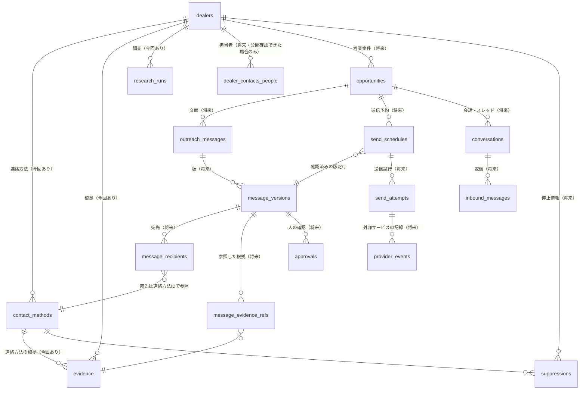

# FUTURE_EMAIL_PLAN — 営業メールの作成・送信・予約・返信管理を追加するための計画（設計の記録）

> **2026-10-26 追記：この計画は版 1.2.0 で実装しました。** 現在の実装状況は [IMPLEMENTATION_STATUS.md](IMPLEMENTATION_STATUS.md)、使い方は [README.md](README.md) の「4. 営業メール」、外部サービスの公式仕様の確認記録は [docs/EXTERNAL_SERVICES.md](docs/EXTERNAL_SERVICES.md) を参照してください。外部サービス（Gmail・Outlook・SMTP・Claude API）との実際の接続は、利用者のアカウントがないため引き続き**未検証**です。
> 以下は第1段階のときに書いた計画で、設計の経緯として残しています（実装では細部を変えた箇所があります）。

この文書は第1段階のときの**将来の計画**です。第1段階ではメールの作成・送信・予約・返信管理を実装していませんでした。

第1段階の完成条件は「今回のデータを失わずに拡張できる構造があり、次に追加する処理と変更点が具体化されていること」です。

---

## 1. 今回実装した基礎（第1段階）

| 基礎 | 実装場所 | 将来機能での使い道 |
|---|---|---|
| 変更されない販売店ID `DLR-<ULID>` | `dealers.id`（`sdr/ids.py`） | 営業案件・宛先・履歴を販売店に結び付ける。店名・URL・メールが変わっても追跡できる |
| 連絡方法を販売店と別記録 `CNT-<ULID>` | `contact_methods`（1社に複数。種類・取得元・初回/最終観測・人の確認日時・状態・担当者名/役職） | 宛先候補は連絡方法IDで参照する。古い値も `is_current=0` で残るため、過去に送った宛先の根拠を失わない |
| 根拠（出典URL・抜粋・観測日時・調査ID） | `evidence`、`research_runs` | AI や定型文に渡すのは「確認済みの事実＋根拠」だけにできる。文面がどの調査版を参照したか追える |
| 自動取得値と人の確定値の分離 | `dealers.*_auto` / `*_manual`、`contact_methods.status_auto` / `status_manual` | 文面に使う情報を「人が確定したもの」に限定できる |
| 変更履歴 | `change_log` | 宛先変更・状態変更を送信前の再確認に使う |
| 意味の分離 | 調査状態（`research_status`）・分類（`categories_*`）・人の確認（`review_status`）・対象判断（`eligibility_manual`）は別の列 | 営業状況・連絡拒否を**さらに別のテーブル**として追加しても混ざらない |
| データベースの版管理 | `schema_meta.schema_version`、`sdr/db.py` の `MIGRATIONS` | 将来テーブルを「版 2 以降」として追加。更新前に自動バックアップ、失敗時は巻き戻し |
| 処理の分離 | 候補発見 `discovery.py`／取得 `fetcher.py`／抽出 `extract.py`／ルール分類・概要 `classify.py`／保存 `repo.py`／画面 `web.py` | 文面作成・送信を別モジュールとして追加し、調査処理から直接送信しない構造にする |
| 秘密情報の分離 | `secrets.json`（DB・バックアップ・CSV に含めない） | メールアカウントの認証情報も同じ方針で送信機能だけが読む |
| 共有モードの認証・CSRF | `sdr/auth.py` | 送信操作を「ログインした人の確認操作」として記録できる |
| バックアップ・復元 | `sdr/backup.py` | 送信予約・送信履歴も DB 単位で保全（ただし復元時の扱いは第6節） |

---

### iPhone 版（`mobile/`：Cloudflare Workers ＋ D1）での同じ基礎

| 基礎 | iPhone 版での実装場所 |
|---|---|
| 販売店ID・連絡方法ID（PC 版と同じ形式） | `mobile/src/util.ts`（`newId`）、`schema.ts` の版 1（表の構造は PC 版と互換） |
| 根拠・調査記録・変更履歴・自動値と人の確定値の分離 | `schema.ts`、`repo.ts` |
| 版管理 | `schema.ts` の `MIGRATIONS`（D1 の batch で版ごとに適用・失敗時は巻き戻し）。既存データがある DB は、画面で「バックアップを保存」を確認してから管理者が更新 |
| 処理の分離 | 発見 `discovery.ts`／取得 `fetcher.ts`・`netsafe.ts`／読み取り `parse.ts`・`extract.ts`／判定 `classify.ts`・`analyse.ts`／保存 `repo.ts`／進行 `engine.ts`／API `index.ts` |
| 秘密情報の分離 | Worker のシークレット（`SETUP_TOKEN`・任意の `FIRECRAWL_API_KEY`）または `secrets` 表（バックアップ・CSV に含めない） |
| ログイン・CSRF・利用者ごとの操作記録 | `auth.ts`、`change_log.changed_by` |

iPhone 版にメール機能を足す場合の要点：

- 将来テーブル（下記）は `schema.ts` に**版 2** として追加します。既存の版 1 は書き換えません。
- 送信は Worker の定期実行（Cron）から 1 件ずつ行う形になります。1 回の処理の CPU 上限（無料 10ms）と外部通信数（1 回 50 件）に収まるよう、「予約の確定」「1 通の送信」「結果の記録」を別のステップに分けます。
- Gmail / Microsoft Graph の OAuth の更新トークンは Worker のシークレットまたは暗号化した `secrets` 表に置き、バックアップには含めません。
- 端末が閉じていても Cron で動くため、PC 版の「送信担当 PC」（`runner_lock`）の代わりに、Worker 1 つだけが送信担当になります。PC 版と iPhone 版の両方から同じ相手に送らないよう、送信機能はどちらか一方でだけ有効にします。
- 送信は無料枠の Workers からも可能ですが、メールサービス側の送信上限・規約・認証（SPF/DKIM/DMARC）は別に確認が必要です（未検証）。

---

## 2. 将来のデータ関連図



### 将来テーブル（版 2 以降で追加する案。今回は作っていません）

| テーブル | 主な列 | 意味 |
|---|---|---|
| `opportunities` | `id OPP-…`, `dealer_id`, `title`, `stage`（未着手/送信予定/送信済み/返信あり/商談中/成約/見送り）, `owner`, `created_at`, `closed_at` | 営業案件。**販売店とは別**。同じ店に複数案件（例：2027年春の在庫提案、別車種の提案）を作れる |
| `dealer_contacts_people` | `id PER-…`, `dealer_id`, `name`, `role`, `source_url`, `verified_at` | 公開され確認できた担当者のみ。担当者不明でも案件は作れる |
| `outreach_messages` | `id MSG-…`, `opportunity_id`, `purpose`（初回/2回目/3回目/再営業）, `created_by` | 文面の束 |
| `message_versions` | `id`, `message_id`, `version_no`, `subject`, `body`, `attachments_json`（ファイル名・SHA-256）, `generator`（manual/template/ai）, `generator_detail`, `source_snapshot_json`（参照した販売店情報の版・確認日時）, `content_hash`, `created_at` | 文面の版。**内容が変われば必ず新しい版**。`content_hash` は宛先・件名・本文・添付をまとめたハッシュ |
| `message_recipients` | `version_id`, `contact_method_id`, `address_snapshot`, `role`（to/cc） | 宛先は連絡方法IDと、その時点のアドレスの写しを持つ |
| `message_evidence_refs` | `version_id`, `evidence_id` | 文面が根拠として使った調査情報 |
| `approvals` | `id`, `version_id`, `content_hash`, `approved_by`, `approved_at` | 人が宛先・件名・本文・添付を確認した記録。**承認時の `content_hash` が現在の版と一致しなければ無効** |
| `send_schedules` | `id SCH-…`, `opportunity_id`, `version_id`, `approval_id`, `scheduled_at_utc`, `display_tz`（Asia/Tokyo / Europe/London）, `local_input`（入力した時刻と地域）, `status`（予約/保留/取消/送信中/送信済み/結果不明/失敗）, `hold_reason`, `sequence_step`, `stop_on_reply`（初回営業の追客は true）, `runner_id` | 送信予約 |
| `send_attempts` | `id`, `schedule_id`, `idempotency_key`, `provider`, `started_at`, `finished_at`, `result`（受付/拒否/結果不明）, `provider_message_id`, `error` | 送信試行。**サーバー受付・実際の配達・相手の閲覧は別の事実**として扱い、ここに残すのは「送信サービスが受け付けたか」まで |
| `provider_events` | `id`, `attempt_id`, `kind`（bounce/delivered/complaint 等）, `received_at`, `raw_ref` | 外部サービスから取得できた事後情報（取得できる場合のみ） |
| `conversations` / `inbound_messages` | `thread_key`, `opportunity_id`, `from`, `received_at`, `snippet`, `classification`（返信/自動応答/配信停止依頼/不達） | 返信・会話 |
| `suppressions` | `id`, `scope`（**company**：会社全体の連絡拒否／**contact**：特定の相手の拒否／**invalid_address**：無効アドレス）, `dealer_id`, `contact_method_id`, `reason`, `source`（返信本文/電話/人の判断）, `recorded_by`, `recorded_at`, `lifted_at` | 停止情報。**3 種類を混同しない**。無効アドレスは「その宛先には送らない」だけで、会社への連絡拒否ではない |
| `outbound_rules` | `key`, `value`, `decided_by`, `decided_at` | 営業送信の可否・法務判断（例：英国 PECR／UK GDPR の扱い、法人宛ての判断）。**未設定＝送信不可** |
| `runner_lock` | `runner_id`, `hostname`, `claimed_at`, `heartbeat_at` | 送信担当の稼働環境を1つに決めるための記録 |

既存テーブルへの追加は最小限にします（`dealers` に営業状況の列は**足さない**。営業状況は `opportunities`、拒否は `suppressions` で持つ）。

### 移行の追加方法（例）

```python
# sdr/db.py
def _migrate_v2(conn):
    conn.execute("CREATE TABLE opportunities (...)")
    conn.execute("CREATE TABLE suppressions (...)")
    ...

MIGRATIONS = [
    (1, "初期構造…", _migrate_v1),
    (2, "営業案件・停止情報", _migrate_v2),   # 既存の版は書き換えず、新しい版として追加
]
```

起動時に自動適用され、適用前に `backups/pre-migration-v1-日時.sqlite3` を作成、失敗時は巻き戻します（試験：`tests/test_data.py::test_migration_adds_column_and_keeps_data`, `test_failed_migration_rolls_back`）。

---

## 3. 追加の順序と各段階の変更点

### 段階 2：文面の作成・編集・保存（送信なし）

- 新規 `sdr/compose/`：
  - `sources.py` … 販売店から**人が確定した値と根拠**だけを集めて `ComposeContext` を作る（未確認の値は「未確認」と明示して渡す、または渡さない）。
  - `providers/manual.py`（手入力）、`providers/template.py`（Jinja2 の定型文。差し込み項目は店名・地域・分類など確定値のみ）、`providers/ai.py`（任意。キーがある場合のみ有効）。共通の `Composer` インターフェース `compose(context, instructions) -> Draft` で切り替える。
  - AI に渡すのは選別した確認済み情報と根拠の抜粋だけ。生成結果は必ず「下書き」として保存し、人が編集・確認するまで送信対象にしない。AI の出力に含まれる事実（例：「御社は SUV 専門」）は、根拠に無ければ画面で警告する。
- 画面：販売店詳細に「営業案件」タブ、案件ごとの文面一覧・版の差分表示。
- 変更しない：`research.py` `fetcher.py` `extract.py` `classify.py`。`repo.py` には案件・文面用の関数を別ファイル `repo_outreach.py` として追加。
- 無料運用への影響：手動・定型文は無料。AI は利用者のキーと上限設定がある場合のみ（調査機能だけの利用には不要のまま）。

### 段階 3：人が確認して既存メールアカウントから送信

- 新規 `sdr/sending/`：
  - `base.py` … `Sender` 境界：`send(envelope, idempotency_key) -> SendResult`。本文作成や調査処理から直接呼ばない。呼べるのは「承認済みの版」を受け取る `dispatch.py` だけ。
  - `smtp.py`（SMTP＋STARTTLS／アプリパスワード）、`gmail.py`（Gmail API・OAuth）、`outlook.py`（Microsoft Graph・OAuth）を順に追加。
  - 認証情報は `secrets.json`（将来は OS の資格情報ストア）に保存し、`sending` だけが読む。DB・バックアップ・CSV・ログに入れない。
- 送信前チェック（すべて満たさなければ送らない）：
  1. 承認の `content_hash` が現在の版（宛先・件名・本文・添付）と一致。
  2. 宛先の連絡方法が `is_current=1` かつ状態が「公開メール確認済み」（または人が確定）。
  3. `suppressions` に会社全体・その相手・無効アドレスの登録がない。
  4. `outbound_rules` で営業送信が「可」と人が決めている（**不明・未設定は送信不可**）。
  5. 承認後に宛先・販売店情報の変更（`change_log`）や返信が無い。あれば「保留」にして再確認を求める。
- 画面：送信確認画面（宛先・件名・本文・添付・参照根拠・停止情報を並べ、最後に人が「送信」）。
- 公開メールの取得と営業送信の許可は別。公開されていることは送信許可を意味しない。

### 段階 4：送信予約（初回・2回目・3回目・再営業）

- `send_schedules` に予約を保存し、`sdr/sending/scheduler.py` が 1 分ごとに期限の来た予約を確認。
- **初期の予約機能は「確認済みの版」を送るだけ**。送信直前の AI 生成・無確認送信はできない（設定項目も作らない）。予約日時の手動設定と AI 生成は別の設定。
- 日時：DB は UTC。入力時は「日本時間／英国時間（Europe/London）」を明示して選ぶ。英国の夏時間切替で存在しない時刻・2 回ある時刻（例：3 月末の 01:30、10 月末の 01:30）は**確定せず、利用者に選び直してもらう**。画面は日本時間と英国時間を並記。
- 追客：初回営業の 2 回目・3 回目は `stop_on_reply=true`。返信・連絡拒否・不達・宛先変更を検知したら、未送信の予約を自動で「保留」または「取消」にする。商談後の再営業は担当者が**新しい予約**として登録する（自動では作らない）。
- 期限切れ：PC 停止中に期限を過ぎた予約は、再起動時に**一括送信しない**。「期限切れ・要確認」として一覧に出し、人が「今送る／日時変更／取消」を選ぶ。予約全体の「一時停止／再開」スイッチを設ける。

### 段階 5：返信・連絡拒否・送信失敗の把握

- `sdr/mailbox/`：Gmail API / Graph / IMAP で、送信した `Message-ID` に対する返信（`In-Reply-To`/`References`）と不達通知を読み取り、`conversations` `inbound_messages` `provider_events` に保存。
- 分類（返信／自動応答／配信停止依頼／不達）はルール＋人の確認。配信停止依頼は `suppressions(scope=contact または company)` の**候補**として表示し、人が確定（明確な依頼は即時に保留扱い）。
- 不達（ハードバウンス）は `suppressions(scope=invalid_address)`。会社全体の拒否とは扱わない。
- 案件の `stage` と予約に反映（返信があれば初回営業の追客は停止）。

---

## 4. 二重送信・結果不明・照合・再起動・復元

- **二重送信防止**：予約ごとに `idempotency_key`（予約ID＋版ハッシュ）を作り、`send_attempts` に「送信中」を書いてから外部へ送る。同じキーで「送信中／送信済み／結果不明」があれば再送しない。Gmail/Graph では送信済みフォルダーをキー（独自ヘッダー `X-SDR-Key` 等）で検索して照合する。
- **結果不明**：タイムアウト等で受付結果が分からない場合は「結果不明・確認待ち」にし、自動再送しない。送信済みフォルダーとの照合で「受付済み」か「未送信」を確定してから人が判断する。
- **事実の区別**：①送信サービスが受け付けた（send_attempts.result）②相手サーバーに配達された（取得できる場合のみ provider_events）③相手が読んだ（原則追跡しない）を別々に記録・表示する。
- **再起動**：起動時に「送信中」のまま残った試行は「結果不明」に変える（自動再送しない）。期限切れ予約は第3節の扱い。
- **バックアップ復元**：復元したデータには、バックアップ後に実際に送った記録が無い可能性がある。復元直後は**全予約を一時停止**し、送信済みフォルダーと照合してから再開する手順を必須にする。
- **複数PCへのコピー**：配布版の DB を別 PC にコピーすると同じ予約が 2 台で実行されうる。`runner_lock` に送信担当の稼働環境（PC 名＋ID）を 1 つだけ登録し、それ以外の PC では送信・予約実行を無効にする（画面に「この PC は送信担当ではありません」）。担当の切替は人の操作で行う。

## 5. 共同運用を本格化する場合（SQLite → PostgreSQL の判断点）

- 現状：共有モード（サーバー PC の SQLite を 1 つのアプリが使う）で 2 人程度は十分。
- 移行を検討する目安：同時利用が 3〜5 人を超える、予約送信を常時稼働のサーバーで動かしたい、複数の送信担当や監査ログの要件が出た、DB が数 GB を超える。
- 手順案：①`repo*.py` の SQL を SQLite/PostgreSQL 共通の書き方に寄せる（`INSERT … ON CONFLICT` は両方対応）②`db.py` に接続先の切替（`SDR_DATABASE_URL`）を追加③移行ツール：SQLite のバックアップ ZIP → 各テーブルを ID を保ったまま COPY④照合（件数・ID・ハッシュ）⑤共有サーバーを正本にし、各 PC の配布版は「閲覧・調査のみ」または使用停止。PostgreSQL のホスティングは有料になる場合が多いため、無料運用の前提が変わる点を利用者が判断する。

## 6. 無料運用への影響

| 機能 | 無料で使えるか（前提） |
|---|---|
| 調査（今回） | 無料。メール設定・AIキー・有料契約は今後も**要求しない** |
| 手動・定型文の作成 | 無料 |
| AI による下書き | 利用者のキーと従量課金次第（任意機能。上限設定を必須にし、自動で有料化しない） |
| SMTP / Gmail / Outlook 送信 | 既存アカウントの範囲で無料のことが多いが、各サービスの送信上限・規約に従う。Gmail API・Graph は OAuth アプリ登録が必要 |
| 予約送信 | アプリを動かす PC が起動している必要あり（停止中は送られない） |
| 返信管理 | 既存アカウントの API/IMAP 次第 |
| 共有・常時稼働 | PC を常時起動するか、有料のサーバー・ドメインが必要になりうる |

## 7. 未決事項（利用者の判断が必要）

1. 営業送信の法務判断（英国 PECR・UK GDPR、法人宛て・個人事業主宛ての扱い、配信停止の文言）と、`outbound_rules` に設定する内容。
2. 使うメールサービス（Gmail / Outlook / 独自ドメインの SMTP）と、送信上限・送信元ドメインの認証（SPF/DKIM/DMARC）。
3. AI を使うか、使う場合の提供元・費用上限・社外に出してよい情報の範囲。
4. 送信担当の PC（または共有サーバー）をどれにするか。
5. 2 回目・3 回目の間隔、返信がない場合の終了条件、再営業の基準。
6. 文面のテンプレート（日本語→英語の翻訳を誰が確認するか）。
7. 担当者名を記録する範囲（公開情報のみ。個人情報の保管期間）。
